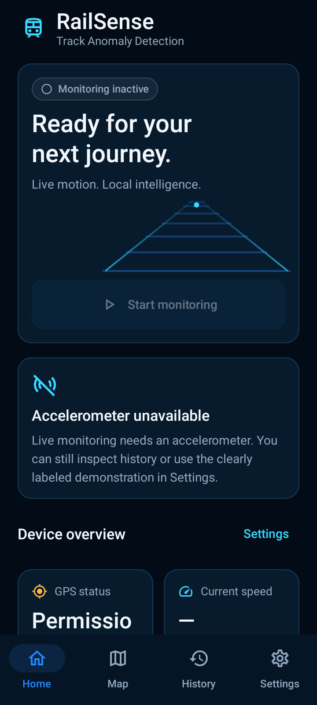
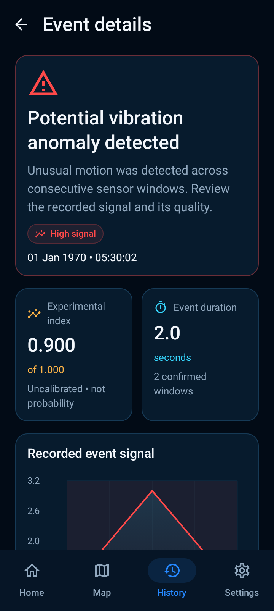
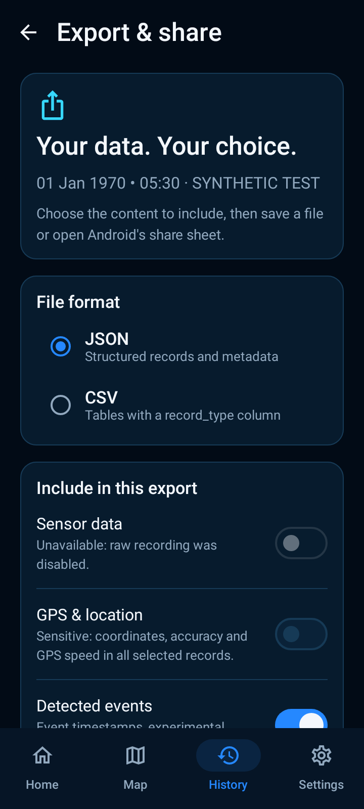
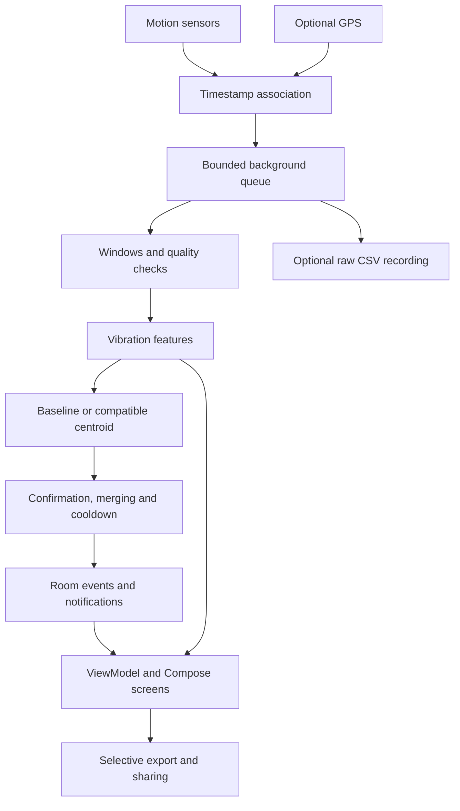

# RailSense

**Smartphone vibration monitoring for railway anomaly research.**

RailSense combines an offline-capable native Android app with a Python research platform. The app collects phone motion signals, identifies potential vibration anomaly candidates, records approximate locations when available, and lets users review and export trips. The research platform compares models across journeys, devices, placements, speeds and routes.

> RailSense is an experimental prototype. Vibration candidates are not confirmed track defects. Synthetic benchmarks and phone demonstrations do not establish railway safety or real-world detection accuracy.

[Download APK](https://github.com/anitej299/RailSense/releases/tag/v3.0.0) · [Documentation](docs/README.md) · [Android setup](mobile/README.md) · [Architecture](docs/architecture.md) · [Contributing](CONTRIBUTING.md)

## Android preview

<p>
  
  
  
</p>

Host-rendered UI test screenshots at 360 dp width. Dates and readings come from a labeled synthetic fixture; they are not field recordings.

## Android features

- User-started foreground monitoring with accelerometer, optional gyroscope and optional GPS.
- Timestamp-aligned windows, measured sample rate, quality checks and local experimental scoring.
- Consecutive-window confirmation, event merging, acknowledgement, local alerts and cooldown.
- Home, Live Monitoring, Alert, Map, History, Settings, Event Details and Export/Share, plus trip details.
- Room history, DataStore settings and optional streamed raw recordings.
- CSV/JSON export with selectable content and location excluded by default; Android sharing.
- Optional OpenStreetMap tiles and recorded routes without a paid API key.
- Labeled synthetic demonstration mode and interrupted-trip recovery.

Core detection requires no backend, Firebase, Google Play Services or network connection. Optional map tiles use the network. No automatic cloud upload is implemented.

## Architecture



`MonitoringService` owns collection independently of screen navigation. `RailSenseViewModel` exposes state to Compose. Sensor callbacks use a dedicated thread; background coroutines perform recording and inference. UI snapshots are limited to five updates per second.

| Setting | Default |
| --- | --- |
| Requested sampling | 50 Hz; actual delivery is measured |
| Window / overlap | 2 seconds / 50% |
| Detection threshold | 0.65 experimental index |
| High signal display band | 0.85; not defect severity |
| Confirmation | Two consecutive eligible windows |
| New-event cooldown | 30 seconds |

The untrained baseline computes `clamp(max(RMS / 4, peakToPeak / 12), 0, 1)` from DC-removed acceleration magnitude. Its score is not a probability. An optional normal-only centroid uses a validated seven-feature JSON contract; no centroid is bundled by default. See [model training](docs/model_training.md).

## Build and run Android

Requirements: Android SDK Platform 35, platform-tools and **JDK 17**. Minimum Android API: 26. The Gradle wrapper is committed. Configure the SDK in Android Studio or an untracked `mobile/local.properties`.

```powershell
git clone https://github.com/anitej299/RailSense.git
Set-Location RailSense\mobile
# Set JAVA_HOME to your installed JDK 17 if needed.
.\gradlew.bat :app:assembleDebug
```

Output: `mobile/app/build/outputs/apk/debug/app-debug.apk`. A ready-to-install debug-signed APK is available in [Releases](https://github.com/anitej299/RailSense/releases/tag/v3.0.0). Store distribution needs an owner-controlled release signing key.

Enable USB debugging, connect the phone and approve the computer:

```powershell
$adb = "$env:LOCALAPPDATA\Android\Sdk\platform-tools\adb.exe"
& $adb devices -l
.\gradlew.bat :app:installDebug
& $adb shell am start -n org.railsense.mobile/.MainActivity
```

Start monitoring from Home and inspect Live Monitoring. After stopping, use **History → View trip details → Export & share**. Settings includes the labeled synthetic demonstration. Location permission is optional for inertial detection.

## Separate research platform

The Python experiments and dashboard are independent of Android's live scorer. They support preprocessing, engineered features, traditional classifiers, temporal neural networks, grouped evaluation, robustness studies, sensor ablations, CORAL domain adaptation and ONNX export.

| Component | Stack |
| --- | --- |
| Android | Kotlin, Compose, Material 3, coroutines/Flow, Room, DataStore, osmdroid |
| Research | Python, NumPy, pandas, SciPy, scikit-learn, PyTorch, optional XGBoost |
| API | FastAPI research inference and experiment inspection |
| Dashboard | React, TypeScript, Vite, Recharts, Leaflet |

The Android app does **not** run the legacy research ONNX model. The API's segment/map endpoints currently use demonstration risk values, not live crowd-sensing predictions.

From the repository root, using the documented Python 3.10–3.12 environment:

```powershell
python -m venv .venv
.\.venv\Scripts\python.exe -m pip install -e ".[dev,xgboost]"
.\.venv\Scripts\python.exe experiments/run_all.py --quick
.\.venv\Scripts\python.exe -m uvicorn api.main:app --reload --port 8000
```

API docs: `http://localhost:8000/docs`. In another terminal with Node.js 22.12 or newer:

```powershell
Set-Location frontend
npm ci
npm run dev
```

Open `http://localhost:5173`. Docker definitions are also provided. Generated datasets, checkpoints and reports are excluded from Git; the experiment runner recreates them under `data/`, `models/` and `results/generated/`.

All default research results are **synthetic development benchmarks**. Hold out complete journeys and evaluate device/placement/route transfer. Real studies need independent labels and the [collection protocol](docs/data_collection_protocol.md).

## Validation

Recorded version 3 validation: **28 Kotlin host tests and four Python mobile-model tests passed**. Android lint: zero errors, 21 warnings. Debug, unsigned release and instrumentation APKs compiled. Six host-rendered screens were inspected.

Version 3 device instrumentation, battery, GPS and field validation remain pending. A compiled instrumentation APK does not establish executed device tests. See the [verification report](docs/ui_verification.md).

```powershell
# From mobile/:
.\gradlew.bat :app:testDebugUnitTest :app:assembleDebug :app:lintDebug
# With a connected Android runtime:
.\gradlew.bat :app:connectedDebugAndroidTest
# From repository root:
.\.venv\Scripts\python.exe -m unittest tests.test_mobile_model -v
.\.venv\Scripts\python.exe -m pytest
```

## Repository map

```text
mobile/        Native Android app, tests and Gradle wrapper
src/           Research processing, features, models and evaluation
experiments/   Reproducible experiment runner
scripts/       Model and data utilities
api/           FastAPI research service
frontend/      React research dashboard
configs/       Research configuration
notebooks/     Analysis notebooks
tests/         Python tests
docs/          Architecture, usage, methodology and verification
```

## Limitations and next steps

Phone handling, rotation, mounting, speed, wheel condition and vehicle dynamics influence vibration. GPS is approximate, and a recorded polyline is not verified rail geometry. Android battery policies can interrupt monitoring. App-private storage has no additional application encryption layer.

Next steps are a permissioned multi-device, multi-route field dataset, inspection-aligned labels, independent validation, calibration and measured phone performance. Read [limitations](docs/limitations.md) and [methodology](docs/research_methodology.md).

## License

[MIT](LICENSE). Experimental research software, not a certified railway inspection system.
