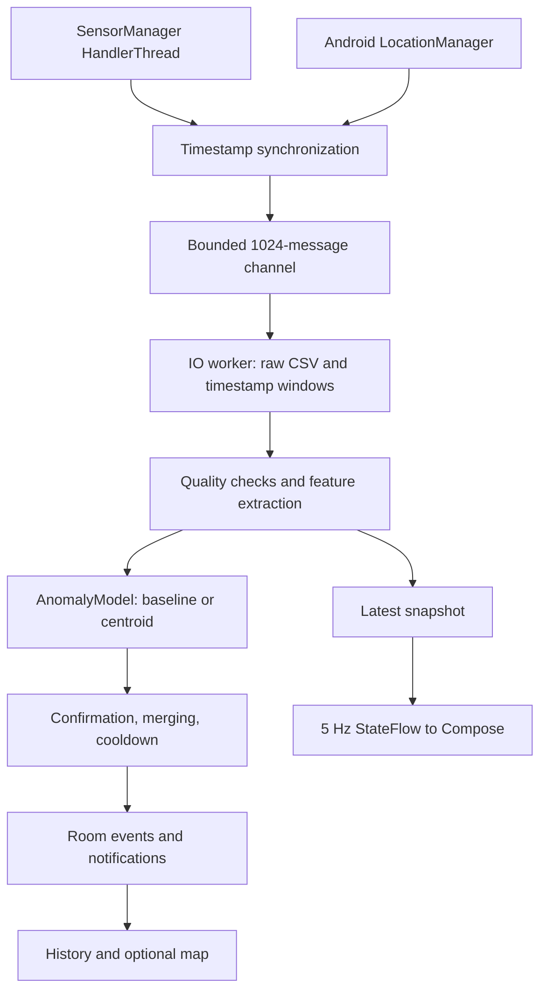

# Android monitoring architecture

The native app in `mobile/` is the primary live detector. Existing Python experiments, API and web dashboard are separate research tools, not prerequisites.

`MonitoringService` owns a session, collectors, bounded channel, model, detector, stream writer and partial wake lock. It starts only from the visible activity, enters the foreground immediately, and returns `START_NOT_STICKY`. A repeated start is ignored. Stop unregisters sensors and locations, closes the channel, drains pending records, closes the writer, updates the trip and releases resources. A timed non-reference-counted wake lock is renewed only during an active session and released on completion. Battery saver/low battery and missing callbacks are displayed. Android or OEM termination remains possible.

`SensorCollector` uses a dedicated HandlerThread. Every stream has an independent monotonic timestamp. Acceleration is the window clock. A bounded history associates only preceding gyro/linear readings within 100 ms and location fixes within 5 seconds. Location uncertainty adds possible travel since the fix (`age × speed`, or 40 m/s when speed is missing); values beyond 100 m are suppressed. This is a conservative heuristic, not a statistically calibrated error bound. GPS wall time and monotonic time are exported separately. Invalid/nonfinite and backward readings are excluded. A requested sampling rate is just a request.

`WindowBuffer` emits time-based 1–5 second windows; default 2 seconds/50% overlap. Its hard cap is 2,048 samples. A callback gap over 500 ms resets window warm-up. A window must cover at least 80% of requested duration, deliver at least 70% of requested frequency and contain no gap over 200 ms. Interval deviations above 50% of their mean mark irregular sampling. Such windows do not trigger candidates. Missing gyro is explicitly `ACCEL_ONLY`: the acceleration baseline can operate; the fusion centroid cannot.

`FeatureExtractor` removes the per-window mean acceleration vector to reduce DC gravity/device offset while preserving vibration amplitude. It does not recover a global orientation: phone rotation within a window remains a confounder. Linear acceleration is collected/displayed/exported when available but not mixed opportunistically into the model contract. Magnitude is rotationally invariant only to a fixed rotation. No broad band-pass is applied. Population RMS, magnitude SD, peak-to-peak, vector jerk RMS, gyro RMS and Hann-tapered magnitude DFT features are calculated off the UI thread. DFT bins are capped at 128. High-band energy starts at 8 Hz. The magnitude transform can double a sinusoid's frequency; these features must not be interpreted as direct track spectra. No spectrum is produced for irregular or insufficient data.

`EventDetector` requires consecutive eligible windows, merges temporally overlapping candidates, and applies cooldown only to new events. An event retains start/end, peak/mean, window count, the peak window's location and feature/waveform excerpt. It updates one Room row per merged event; acknowledgements survive updates. A score is an experimental index, never a calibrated probability.

Room v2 contains trips (device/sensor/model/configuration/recording metadata), events and locations. The v1→v2 migration preserves legacy sensor records and adds the new tables. Foreign keys cascade event/location deletion. New high-rate data is streamed to app-private CSV rather than per-sample Room writes. A two-second metadata checkpoint enables interruption recovery without assuming the app ran while killed. Preferences use DataStore. All database and file operations run on IO coroutines. Export streams CSV or JSON via Android's document picker, with GPS records paged in batches of 500. UI waveforms and scores are bounded, map data is capped at 2,000 points. Very large trip/event histories should eventually be paged too.

Model inference latency is measured at runtime with `System.nanoTime` and displayed separately from the feature pipeline. No device-independent latency claim is made. Sensor queue overflow increments a counter and timestamp-quality checks suppress affected windows; storage failures stop monitoring visibly instead of pretending the recording succeeded.
